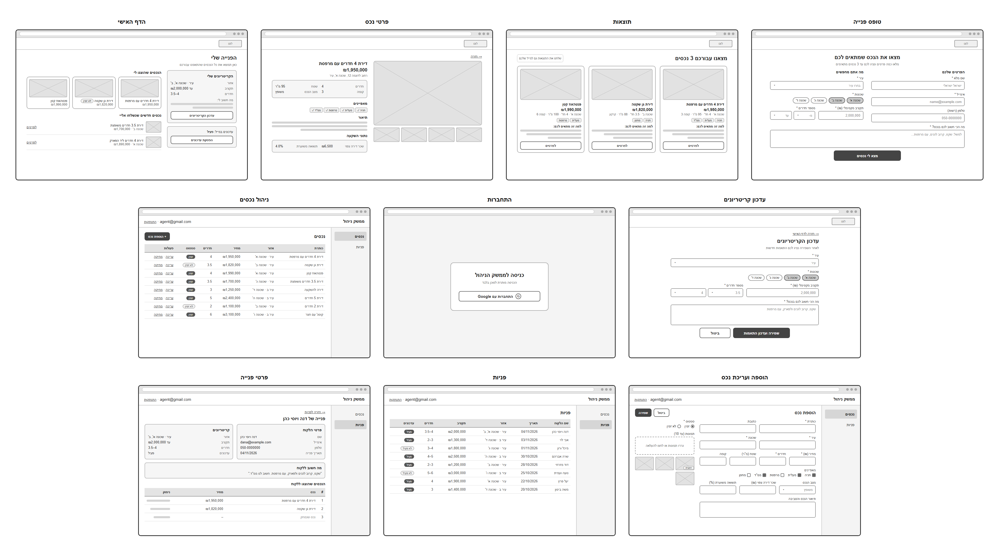
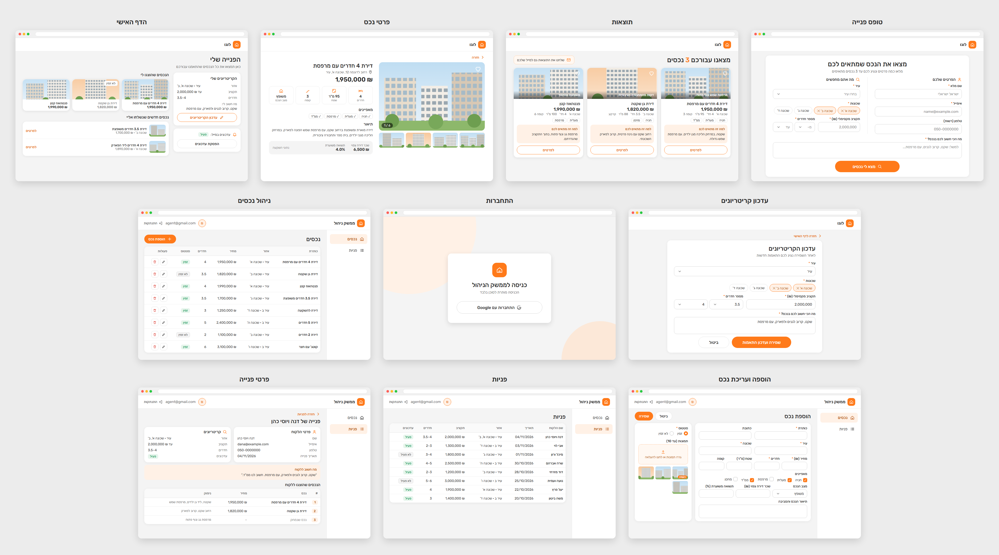
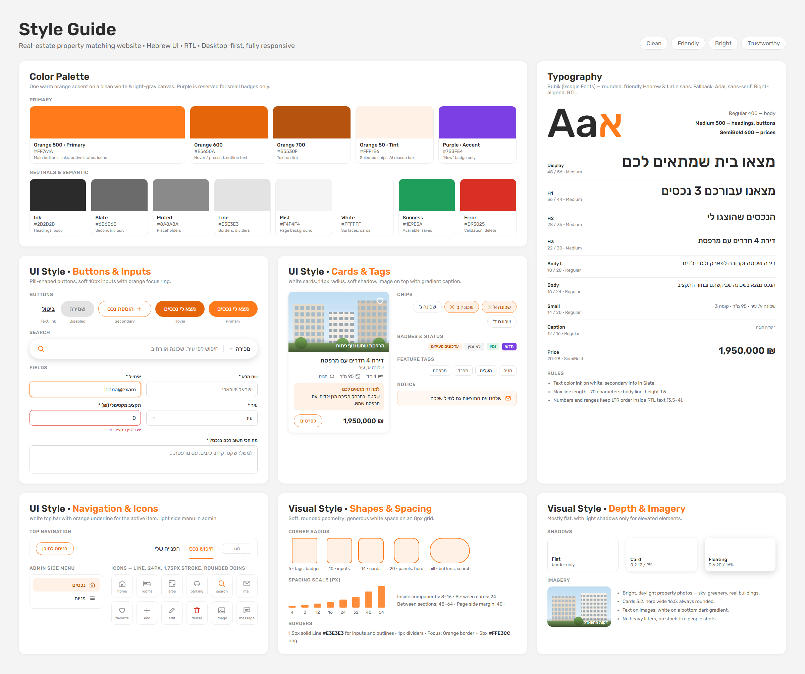

# DESIGN – מערכת התאמת נכסים ללקוחות עבור סוכן נדל"ן

> המסמך הזה מתאר את המימוש העיצובי של המוצר. הוא מתבסס על ארבעה מקורות: [PRD.md](PRD.md), ‏`wireframes.png` (מבנה המסכים), ‏`style-guide.png` (השפה העיצובית) ו-`mockups.png` (המראה הסופי).
> דרישות המוצר ועקרונות ה-UX מתועדים ב-PRD ולא חוזרים כאן.
> פרטים שלא מופיעים במקורות מסומנים כ-**[הנחה]**.

---

## 1. Screens – מסכי האפליקציה

המוצר כולל 10 מסכים, ששייכים לשני ממשקים:

| ממשק | מסכים | Layout משותף |
|---|---|---|
| **אתר הלקוח** (ציבורי, בלי התחברות) | 1–5 | Header לבן עם לוגו בצד ימין. בתחתית Footer לבן ודק עם קו עליון וכפתור קטן "כניסת סוכן" בצד שמאל. ביניהם אזור תוכן, ברוב המסכים על רקע Mist ‏(`#F4F4F4`) עם Panels לבנים. |
| **ממשק הניהול של הסוכן** | 6–10 | המסך הראשון הוא מסך התחברות. בשאר המסכים יש Header לבן עם הכיתוב "ממשק ניהול", תפריט צד מימין ואזור תוכן על רקע Mist. |

גודל הבסיס של כל המסכים הוא מסך Desktop. ה-Mockups מוצגים במסגרת דפדפן, והטקסט בהם קטן יותר בגלל הקנה המידה של התמונה. **הגדלים המחייבים הם אלה שבסעיף Typography.**

---

### 1.1 טופס פנייה

**מטרת המסך:** הלקוח ממלא את הפרטים ואת הקריטריונים שלו, ומקבל עד שלושה נכסים מתאימים.

**מבנה ותוכן:**
- Panel לבן אחד, ממורכז על רקע Mist.
- **כותרת ממורכזת:** "מצאו את הנכס שמתאים לכם". **תת-כותרת:** "מלאו כמה פרטים ונציג לכם עד 3 נכסים מתאימים".
- שני טורים שמופרדים בקו אנכי דק:
  - **טור ימני "הפרטים שלכם"** (עם אייקון משתמש כתום): השדות "שם מלא \*", "אימייל \*" ו"טלפון (רשות)".
  - **טור שמאלי "מה אתם מחפשים"** (עם אייקון חיפוש כתום):
    - Select ‏"עיר \*", עם Placeholder ‏"בחרו עיר".
    - "שכונות \*": Chips לבחירה מרובה. שכונה שנבחרה מופיעה ברקע כתום בהיר, עם הסימן ✕.
    - שורה עם השדה "תקציב מקסימלי (₪) \*" ושני Selects ל"מספר חדרים \*": "מ-" ו"עד".
- **מתחת לשני הטורים:** Textarea ברוחב מלא עם התווית "מה הכי חשוב לכם בנכס? \*", ו-Placeholder ‏"למשל: שקט, קרוב לגנים, עם מרפסת...".
- **כפתור Primary ממורכז:** "מצא לי נכסים", עם אייקון חיפוש.
- כוכבית החובה (\*) מוצגת בכתום.
- **צ'אטבוט (F1):** בועת הצ'אט של Chatling מוצגת בפינת המסך, במסך הזה בלבד. העיצוב שלה, הכותרת והטקסטים שלה מוגדרים בחשבון Chatling, ולא באפליקציה. **[הנחה]** הבועה לא מופיעה בתמונות.

**פעולות וניווט:** לחיצה על "מצא לי נכסים" שולחת את הטופס ומעבירה למסך **תוצאות**.

---

### 1.2 תוצאות

**מטרת המסך:** להציג ללקוח עד שלושה נכסים מתאימים, עם נימוק לכל אחד.

**מבנה ותוכן:**
- **שורת כותרת:** בצד ימין הכותרת "מצאנו עבורכם 3 נכסים", שבה המספר מודגש בכתום. בצד שמאל הודעת Notice ‏"שלחנו את התוצאות גם למייל שלכם", עם אייקון מעטפה.
- **שלושה כרטיסי נכס זה לצד זה**, ברוחב שווה. כל כרטיס כולל:
  - **תמונה ראשית:** בפינה הימנית העליונה אייקון לב לבן. בתחתית התמונה כיתוב לבן על Gradient כהה, למשל "מרפסת שמש ונוף פתוח".
  - **כותרת הנכס, ומתחתיה המחיר** ב-SemiBold.
  - **שורת פרטים באפור:** שכונה, מספר חדרים, שטח וקומה.
  - **Feature tags:** למשל חניה, מעלית וממ"ד.
  - **תיבת נימוק ברקע Orange 50:** הכותרת "למה זה מתאים לכם" בצבע Orange 700, ומתחתיה טקסט הנימוק.
  - **כפתור Secondary ברוחב מלא:** "לפרטים".

**פעולות וניווט:** לחיצה על "לפרטים" פותחת את מסך **פרטי נכס** של הנכס הזה.

---

### 1.3 פרטי נכס

**מטרת המסך:** להציג את כל המידע על נכס שהוצג ללקוח.

**מבנה ותוכן:**
- **קישור חזרה** בכתום בראש המסך: "חזרה", עם חץ.
- **פריסה בשני טורים:**
  - **טור ימני – גלריה:**
    - תמונה ראשית גדולה עם פינות מעוגלות. בפינה הימנית העליונה אייקון לב, ובפינה השמאלית התחתונה מונה תמונות, למשל "1 / 6".
    - מתחת לתמונה ארבע Thumbnails. התמונה שמוצגת כרגע מסומנת במסגרת כתומה.
  - **טור שמאלי – פרטים:**
    - כותרת הנכס, ומתחתיה הכתובת עם אייקון מיקום והמחיר בגודל גדול.
    - **כפתורי יצירת קשר עם הסוכן** (PRD F10), מתחת למחיר, זה לצד זה: כפתור Primary ‏"התקשרו לסוכן" עם אייקון טלפון, וכפתור Secondary ‏"WhatsApp" עם אייקון הודעה. ברוחב מובייל כל כפתור ממלא חצי שורה. אם מספר הטלפון של הסוכן לא הוגדר, הכפתורים לא מוצגים. **הערה:** הכפתורים לא מופיעים ב-Wireframes וב-Mockups, והטקסט כאן מוסיף אותם.
    - **ארבע קוביות נתונים:** חדרים, שטח, קומה ומצב הנכס. כל קובייה כוללת אייקון כתום, ערך ותווית.
    - **"מאפיינים":** Feature tags עם הסימן ✓.
    - **"תיאור":** פסקת טקסט.
    - **Panel אפור "נתוני השקעה":** שכר דירה צפוי ותשואה משוערת.

**פעולות וניווט:**
- "חזרה" מחזיר למסך שממנו הלקוח הגיע: מסך **תוצאות** או **הדף האישי**.
- לחיצה על Thumbnail מחליפה את התמונה הראשית. **[הנחה]**
- "התקשרו לסוכן" פותח חיוג למספר הסוכן. "WhatsApp" פותח את WhatsApp בלשונית חדשה, עם הודעה מוכנה על הנכס (PRD F10).

---

### 1.4 הדף האישי

**מטרת המסך:** הלקוח חוזר לפנייה שלו דרך הקישור האישי, רואה את כל ההתאמות ומנהל את הקריטריונים ואת העדכונים.

**מבנה ותוכן:**
- **כותרת:** "הפנייה שלי". **תת-כותרת:** "כאן תמצאו את כל הנכסים שהתאמנו עבורכם".
- **עמודה ימנית צרה, עם שני Panels:**
  1. **"הקריטריונים שלי":** אזור, תקציב, חדרים ו"מה חשוב לי". בתחתית כפתור Secondary ‏"עדכון הקריטריונים", עם אייקון עריכה.
  2. **מצב העדכונים:** אייקון פעמון, הטקסט "עדכונים במייל:" ותגית סטטוס "פעיל". מתחתיהם כפתור משני ניטרלי, עם מסגרת אפורה: "הפסקת עדכונים".
- **אזור תוכן משמאל:**
  - **"הנכסים שהוצגו לי":** שלושה כרטיסים קטנים, עם תמונה, כותרת ומחיר. נכס שאינו זמין מסומן בתגית "לא זמין" על התמונה, והטקסט שלו מוצג באפור.
  - **"נכסים חדשים שנשלחו אליי":** רשימה בתוך Panel. בכל שורה יש Thumbnail, כותרת, שכונה ומחיר, וקישור "לפרטים".

**פעולות וניווט:**
- לחיצה על כרטיס נכס או על "לפרטים" פותחת את מסך **פרטי נכס**.
- "עדכון הקריטריונים" מעביר למסך **עדכון קריטריונים**.
- "הפסקת עדכונים" פותח חלון אישור, לפי ה-PRD. החלון אינו מסך נפרד, ולכן אינו מופיע ב-Mockups.

---

### 1.5 עדכון קריטריונים

**מטרת המסך:** לשנות את הקריטריונים של הפנייה ולקבל התאמות חדשות.

**מבנה ותוכן:**
- **קישור חזרה:** "חזרה לדף האישי".
- **Panel לבן ממורכז ברוחב מצומצם:**
  - **כותרת:** "עדכון הקריטריונים". **תת-כותרת:** "לאחר השמירה נציג לכם התאמות חדשות".
  - **שדות:** "עיר \*", "שכונות \*" (Chips), "תקציב מקסימלי (₪) \*", "מספר חדרים \*" (שני Selects) ו"מה הכי חשוב לכם בנכס? \*". השדות מגיעים מלאים בערכים הנוכחיים של הפנייה.
  - **כפתורים ממורכזים:** Primary ‏"שמירה ועדכון התאמות", ולצידו כפתור ניטרלי "ביטול".

**פעולות וניווט:**
- "שמירה ועדכון התאמות" מחזיר ל**דף האישי**, עם ההתאמות המעודכנות.
- "ביטול" ו"חזרה לדף האישי" חוזרים לדף האישי בלי לשמור.

---

### 1.6 התחברות

**מטרת המסך:** כניסה של הסוכן לממשק הניהול.

**מבנה ותוכן:**
- רקע Mist עם שני עיגולים דקורטיביים בגווני כתום בהיר.
- **כרטיס לבן ממורכז** עם צל Floating:
  - הלוגו: ציור לבן של בית מול שמש בתוך ריבוע כתום מעוגל.
  - **כותרת:** "כניסה לממשק הניהול". **תת-כותרת:** "הכניסה מותרת לסוכן בלבד".
  - **שדות "כתובת מייל" ו"סיסמה"** (כיוון LTR), ומתחתם **כפתור ראשי ברוחב מלא:** "כניסה".
  - הודעות שגיאה (מייל או סיסמה שגויים, הרשאה, כישלון) מוצגות מעל הטופס בצבע Error.
  - **הערה:** בתמונות ה-Wireframes וה-Mockups מופיע כפתור "התחברות עם Google". הוא הוחלף בטופס מייל וסיסמה לפי החלטת המשתמש (ARCHITECTURE.md, ‏ADR-9), והטקסט כאן גובר על התמונות במסך הזה.
- במסך הזה אין Header ואין תפריט צד.

**פעולות וניווט:** אחרי התחברות מוצלחת, הסוכן מועבר למסך **ניהול נכסים**.

---

### 1.7 ניהול נכסים

**מטרת המסך:** לצפות בכל הנכסים במאגר ולנהל אותם.

**מבנה ותוכן:**
- **Header של ממשק הניהול:** בצד ימין אייקון לוגו והכיתוב "ממשק ניהול". בצד שמאל Avatar עגול עם האות הראשונה, כתובת המייל של הסוכן וקישור "התנתקות" עם אייקון.
- **תפריט צד:** הפריטים "נכסים" ו"פניות", כל אחד עם אייקון. הפריט הפעיל, "נכסים", מוצג ברקע Orange 50, בטקסט Orange 700 ובמשקל Medium.
- **כותרת:** "נכסים". בצד שמאל כפתור Primary קטן: "+ הוספת נכס".
- **טבלה בתוך Panel לבן**, עם העמודות כותרת, אזור, מחיר, חדרים, סטטוס ופעולות.
  - עמודת הסטטוס מוצגת כתגית: "זמין" בירוק, "לא זמין" באפור.
  - בעמודת הפעולות יש שני כפתורי אייקון קטנים: עריכה, ומחיקה באדום.

**פעולות וניווט:**
- "+ הוספת נכס" ואייקון העריכה מעבירים למסך **הוספה ועריכת נכס**.
- אייקון המחיקה פותח בקשת אישור, לפי ה-PRD.
- "פניות" בתפריט הצד מעביר למסך **פניות**.
- "התנתקות" מחזיר למסך **התחברות**.

---

### 1.8 הוספה ועריכת נכס

**מטרת המסך:** להזין נכס חדש או לערוך נכס קיים. אותו מסך משמש לשתי הפעולות.

**מבנה ותוכן:**
- **שורת כותרת:** "הוספת נכס". במצב עריכה הכותרת מוחלפת ל"עריכת נכס". **[הנחה]** בצד שמאל הכפתורים "ביטול" (ניטרלי) ו"שמירה" (Primary).
- **Panel ימני רחב – שדות הנכס:**
  - כותרת \*, כתובת.
  - עיר \*, שכונה \*.
  - מחיר (₪) \*, חדרים \*, שטח (מ"ר), קומה.
  - "מאפיינים": Checkboxes לחניה, מעלית, מרפסת, ממ"ד ומחסן. Checkbox מסומן מוצג ברקע כתום עם ✓.
  - מצב הנכס (Select), שכר דירה צפוי (₪), תשואה משוערת (%).
  - "תיאור הנכס והסביבה" (Textarea).
- **Panel שמאלי צר:**
  - "סטטוס \*": שני Radio buttons, "זמין" ו"לא זמין". הבחירה הפעילה מסומנת בכתום.
  - "תמונות (עד 10)":
    - אזור העלאה עם מסגרת מקווקוות כתומה, רקע כתום בהיר, אייקון העלאה והטקסט "גררו תמונות או לחצו להעלאה".
    - מתחת לאזור ההעלאה יש Grid של Thumbnails, שלוש תמונות בכל שורה. התמונה הראשית מסומנת במסגרת כתומה ובתגית "ראשית".
- תפריט הצד מציג את "נכסים" כפריט הפעיל.

**פעולות וניווט:** "שמירה" ו"ביטול" מחזירים למסך **ניהול נכסים**.

---

### 1.9 פניות

**מטרת המסך:** לצפות בכל הפניות שהתקבלו מלקוחות.

**מבנה ותוכן:**
- Header ותפריט צד של ממשק הניהול. הפריט הפעיל בתפריט הוא "פניות".
- **כותרת:** "פניות".
- **טבלה בתוך Panel לבן**, עם העמודות שם הלקוח, תאריך, אזור, תקציב, חדרים, עדכונים ופעולות.
  - שם הלקוח מוצג במשקל Medium.
  - טווח החדרים מוצג בסדר LTR, למשל "3.5–4".
  - בעמודת העדכונים מוצגת תגית: "פעיל" בירוק, "לא פעיל" באפור.
  - בעמודת הפעולות יש כפתור אייקון קטן אחד: מחיקה באדום, כמו בטבלת הנכסים. **[הנחה]** העמודה לא מופיעה ב-Mockups.

**פעולות וניווט:**
- לחיצה על שורה פותחת את מסך **פרטי פנייה**. לחיצה על אייקון המחיקה לא פותחת את הפנייה.
- אייקון המחיקה פותח בקשת אישור, לפי ה-PRD. אחרי המחיקה הסוכן נשאר במסך **פניות**, ומוצגת ההודעה "הפנייה נמחקה".

---

### 1.10 פרטי פנייה

**מטרת המסך:** להציג את כל פרטי הפנייה. מלבד מחיקת הפנייה, המסך מיועד לקריאה בלבד.

**מבנה ותוכן:**
- **קישור חזרה:** "חזרה לפניות". **כותרת:** "פנייה של [שם הלקוח]". **[הנחה]** בצד שמאל של שורת הכותרת כפתור Neutral קטן "מחיקת פנייה", עם אייקון מחיקה באדום. הכפתור לא מופיע ב-Mockups.
- **שני Panels זה לצד זה:**
  - **"פרטי הלקוח"** (אייקון משתמש): שם, אימייל, טלפון ותאריך פנייה.
  - **"קריטריונים"** (אייקון חיפוש): אזור, תקציב, חדרים, ועדכונים כתגית סטטוס.
- **תיבה ברקע Orange 50:** הכותרת "מה חשוב ללקוח", ומתחתיה הטקסט החופשי של הלקוח במירכאות.
- **"הנכסים שהוצגו ללקוח":** טבלה עם העמודות #, נכס, מחיר ונימוק.
  - מספר הדירוג מוצג בתגית כתומה בהירה.
  - נכס שנמחק מוצג באפור, עם הטקסט "נכס שנמחק" ומחיר "–".

**פעולות וניווט:**
- "חזרה לפניות" ו"פניות" בתפריט הצד מחזירים למסך **פניות**. אין במסך פעולות עריכה.
- "מחיקת פנייה" פותח בקשת אישור. אחרי המחיקה הסוכן מועבר למסך **פניות**, ומוצגת ההודעה "הפנייה נמחקה".

---

### 1.11 מבנה הניווט

**אתר הלקוח:** אין בו תפריט ניווט. הלקוח מגיע למסכים בשתי דרכים, ובתוך האתר הוא עובר ביניהם בכפתורים ובקישורי "חזרה":
1. **מהאתר:** טופס פנייה ← תוצאות ← פרטי נכס.
2. **מהקישור האישי במייל:** הדף האישי. ממנו הוא יכול לעבור למסך פרטי נכס, או לעדכון קריטריונים ובחזרה לדף האישי.

**כפתור "כניסת סוכן":** בתחתית כל מסכי אתר הלקוח יש Footer דק: רקע לבן, קו Line עליון, גובה כ-56px. בצד שמאל כפתור Secondary קטן "כניסת סוכן", עם אייקון משתמש: רקע לבן, גבול Orange 500, טקסט Orange 600 בגודל Small, ו-Hover כמו בכפתור Secondary. כך הוא בולט יותר מקישור טקסט. הכפתור מוביל ל-`/admin/properties`. **[הנחה]** העיצוב של ה-Footer ושל הכפתור לא מופיע בתמונות.

**ממשק הניהול:**
- הכניסה היא דרך מסך התחברות, או מהכפתור "כניסת סוכן" בתחתית אתר הלקוח.
- אחרי ההתחברות, הניווט הראשי הוא תפריט הצד, שמוביל ל"נכסים" ול"פניות".
- **מסכי משנה:** הוספה ועריכת נכס נפתח מתוך ניהול נכסים, ופרטי פנייה נפתח מתוך פניות. החזרה מהם היא בכפתור או בקישור "חזרה", או דרך תפריט הצד.
- "התנתקות" ב-Header זמין בכל מסכי הניהול.

---

## 2. Style Guide – השפה העיצובית

**האווירה הכללית:** נקייה, ידידותית, בהירה ומעוררת אמון. רוב הממשק לבן ואפור בהיר, עם צבע הדגשה כתום וחם אחד. הסגנון שואב השראה מאתרי נדל"ן מובילים בישראל.

### 2.1 Color Palette

| שם | HEX | שימוש |
|---|---|---|
| **Orange 500 – Primary** | `#FF7A1A` | כפתורי Primary, קישורים, מצבים פעילים, אייקונים מודגשים, כוכבית חובה |
| **Orange 600** | `#E5650A` | Hover ו-Pressed של כפתור Primary, טקסט של כפתור Secondary ושל קישורים |
| **Orange 700** | `#B5530F` | טקסט על רקע Orange 50, כמו Chip שנבחר, פריט פעיל בתפריט וכותרת תיבת הנימוק |
| **Orange 50 – Tint** | `#FFF1E6` | Chips שנבחרו, תיבת הנימוק, פריט פעיל בתפריט הצד, רקע ה-Avatar |
| **Purple – Accent** | `#7B3FE4` | תגית "חדש" בלבד. לא בשימוש במסכים הנוכחיים. |
| **Ink** | `#2B2B2B` | כותרות וטקסט ראשי |
| **Slate** | `#6B6B6B` | טקסט משני ותוויות של פרטים |
| **Muted** | `#8A8A8A` | Placeholders ופריטים לא זמינים |
| **Line** | `#E3E3E3` | גבולות, מפרידים ומסגרות של כפתורים ניטרליים |
| **Mist** | `#F4F4F4` | רקע עמודים ו-Panels אפורים |
| **White** | `#FFFFFF` | משטחים, כרטיסים, Header |
| **Success** | `#1E9E5A` | תגיות "זמין" ו"פעיל", על רקע `#E6F5EC` |
| **Error** | `#D93025` | שגיאות ולידציה ואייקון מחיקה |

**צבעי עזר שמופיעים במקורות:**
- `#D6D6D6`: הגבול של שדות קלט.
- `#FFE3CC`: טבעת Focus סביב שדה פעיל.
- `#FFF8F2` ו-`#FFD2AE`: רקע וגבול של רכיב Notice.
- `#FAFAFA`: רקע של כותרות טבלה.

### 2.2 Typography

- **גופן:** **Rubik**, מ-Google Fonts. גופן עגול וידידותי שתומך בעברית ובאנגלית. גופן גיבוי: Arial, ‏sans-serif.
- **משקלים:**
  - Regular 400: טקסט רגיל.
  - Medium 500: כותרות, כפתורים ותוויות.
  - SemiBold 600: מחירים.

| רמה | גודל / גובה שורה | משקל | דוגמה לשימוש |
|---|---|---|---|
| Display | 48 / 56 | Medium | כותרת ראשית גדולה **[הנחה: לא בשימוש במסכים הנוכחיים]** |
| H1 | 36 / 44 | Medium | כותרת המסך, למשל "מצאנו עבורכם 3 נכסים" |
| H2 | 28 / 36 | Medium | כותרת של אזור, למשל "הנכסים שהוצגו לי" |
| H3 | 22 / 30 | Medium | כותרת כרטיס או נכס |
| Body L | 18 / 28 | Regular | טקסט מודגש, תיאורים |
| Body | 16 / 24 | Regular | טקסט רגיל, שדות קלט |
| Small | 14 / 20 | Regular | פרטים משניים ותוויות |
| Caption | 12 / 16 | Regular | הערות, כמו "\* שדה חובה" |
| Price | 20–28 | SemiBold | מחירים |

**כללים:**
- טקסט ראשי בצבע Ink, ומידע משני בצבע Slate.
- גובה השורה של טקסט רגיל הוא 1.5, ואורך שורה מרבי הוא כ-70 תווים.
- מספרים וטווחים נשמרים בסדר LTR בתוך טקסט RTL. לדוגמה, "3.5–4" ולא "4–3.5".

### 2.3 UI Style

**כפתורים:** כל הכפתורים בצורת גלולה (Radius 999). גובה רגיל 48px, וגובה קטן כ-34–38px.

| סוג | מראה | שימוש |
|---|---|---|
| Primary | רקע Orange 500, טקסט לבן. ב-Hover הרקע הופך ל-Orange 600. | הפעולה הראשית במסך: "מצא לי נכסים", "שמירה", "+ הוספת נכס" |
| Secondary | רקע לבן, גבול Orange 500 בעובי 1.5px, טקסט Orange 600 | "לפרטים", "עדכון הקריטריונים" |
| Neutral | רקע לבן, גבול Line, טקסט Ink | "ביטול", "הפסקת עדכונים" |
| Text link | טקסט Orange 600 עם חץ, או טקסט עם קו תחתון | "חזרה", "לפרטים" ברשימות |
| Disabled | רקע Line, טקסט Muted | כפתור שאינו זמין |
| Icon button | ריבוע 28px עם Radius 8 וגבול Line | עריכה ומחיקה בטבלה |

**שדות קלט:**
- רקע לבן, גבול `#D6D6D6` בעובי 1.5px ו-Radius 10. הגובה כ-46px, וב-Mockups כ-38px.
- התווית ממוקמת מעל השדה, ב-14px ובמשקל Medium.
- **מצבים:**
  - **Focus:** גבול Orange 500, עם טבעת `#FFE3CC` ברוחב 3px.
  - **שגיאה:** גבול Error, ומתחת לשדה הודעה בצבע Error.
- **Select:** חץ `chevron` בצד שמאל.
- **Textarea:** אותו סגנון כמו שדה קלט, בגובה כ-70–84px.
- **Checkbox:** ריבוע 16px. במצב מסומן יש לו רקע Orange 500 וסימן ✓ לבן.
- **Radio:** עיגול 16px. במצב מסומן יש לו מסגרת כתומה עבה.
- **Chips לבחירה:** גלולה בגובה 30–36px עם גבול Line. Chip שנבחר מוצג עם גבול Orange 500, רקע Orange 50, טקסט Orange 700 והסימן ✕.

**כרטיסים ו-Panels:**
- **כרטיס נכס:**
  - רקע לבן, Radius 14 וצל Card.
  - התמונה בראש הכרטיס, עם כיתוב לבן על Gradient כהה בתחתית התמונה ואייקון לב לבן בפינה הימנית העליונה.
  - בגוף הכרטיס, לפי הסדר: כותרת, מחיר, פרטים, Feature tags, תיבת נימוק וכפתור.
- **Panel:** רקע לבן, Radius 14 וצל עדין. משמש לקיבוץ שדות ונתונים.
- **תיבת נימוק / "מה חשוב ללקוח":** רקע Orange 50 ו-Radius 10. הכותרת בצבע Orange 700 ובמשקל Medium.
- **Notice:** רקע `#FFF8F2`, גבול `#FFD2AE`, אייקון כתום ו-Radius 10.

**תגיות:**
- **Badge:** פינות עם Radius 6 ופונט בגודל 12 במשקל Medium.
  - "זמין" ו"פעיל": ירוק על רקע ירוק בהיר.
  - "לא זמין" ו"לא פעיל": אפור על רקע Mist.
  - מספר דירוג: Orange 700 על רקע Orange 50.
  - "ראשית": לבן על רקע כתום.
- **Feature tag:** רקע לבן, גבול Line ו-Radius 6. אפשר להוסיף את הסימן ✓ לפני הטקסט.

**טבלאות:**
- הטבלה נמצאת בתוך Panel לבן.
- כותרות העמודות על רקע `#FAFAFA`, בטקסט Slate ובמשקל Medium.
- השורות מופרדות בקו דק `#F0F0F0`.
- העמודה הראשית, למשל כותרת הנכס או שם הלקוח, מוצגת במשקל Medium.

**ניווט:**
- **Header של אתר הלקוח:** רקע לבן, קו תחתון דק ולוגו בצד ימין. הלוגו הוא ריבוע כתום מעוגל ובתוכו ציור לבן של בית מול שמש, בקו בסגנון האייקונים. אותו לוגו משמש גם במסך ההתחברות, בלשונית הדפדפן ובראש המיילים. באתר הלקוח ובמיילים מוצג האייקון בלבד, בלי טקסט לידו.
- **Header של ממשק הניהול:** אותו מבנה, עם הכיתוב "ממשק ניהול". בצד שמאל Avatar עגול, עם גבול כתום, רקע Orange 50 והאות הראשונה של שם הסוכן. לידו כתובת המייל וקישור "התנתקות".
- **תפריט צד בממשק הניהול:** רוחב כ-170px, רקע לבן וקו מפריד. כל פריט כולל אייקון וטקסט, עם Radius 8. הפריט הפעיל מוצג ברקע Orange 50, בטקסט Orange 700 ובמשקל Medium.

**אייקונים:** אייקוני Line בגודל 24px, עם קו בעובי 1.75px ופינות וחיבורים מעוגלים. האייקונים בשימוש:
- home, rooms (מיטה), area, floor, parking, search
- mail, bell, favorite (לב), add, edit, delete
- image, upload, user, location, logout, chevron, back
- phone, message (כפתורי יצירת קשר עם הסוכן, PRD F10)

צבע ברירת המחדל של אייקון הוא Ink. אייקון מודגש מוצג בכתום, ואייקון מחיקה מוצג ב-Error.

### 2.4 Visual Style

**פינות מעוגלות (Radius):**

| ערך | שימוש |
|---|---|
| 6 | תגיות ו-Badges |
| 8 | Icon buttons ופריטי תפריט |
| 10 | שדות קלט, Notice ותיבות נימוק |
| 14 | כרטיסים, Panels ותמונות |
| 20 | Panels גדולים ו-Hero |
| 999 (גלולה) | כפתורים, Chips ושורת חיפוש |

**קווי מתאר:**
- 1.5px בצבע Line לשדות קלט ולמסגרות של כפתורים ניטרליים.
- 1px לקווים מפרידים.

**צללים:**
- **Flat:** גבול בלי צל.
- **Card:** `0 2px 12px rgba(0,0,0,0.09)`, לכרטיסי נכס ול-Panels.
- **Floating:** `0 6px 20px rgba(0,0,0,0.16)`, לכרטיס ההתחברות ולשורת חיפוש.

**מרווחים:** הממשק בנוי על Grid של 8px. סולם המרווחים הוא 4, 8, 12, 16, 24, 32, 48 ו-64.
- בתוך רכיבים: 8–16.
- בין כרטיסים: 16–24.
- בין אזורים: 48–64.
- שוליים בצידי העמוד: 40 ומעלה.

**Layout:**
- **בסיס Desktop:** Header קבוע בראש העמוד, ומתחתיו אזור תוכן.
- **אתר הלקוח:** טפסים מוצגים ב-Panel ממורכז. מסך התוצאות ומסך פרטי הנכס משתמשים ב-Grid של שלוש עמודות או של שני טורים, והדף האישי מחולק לעמודה צדדית ותוכן ראשי.
- **ממשק הניהול:** תפריט צד מימין ואזור תוכן על רקע Mist.
- **מובייל:** פריסת המובייל לא מוצגת ב-Mockups. **[הנחה]** במסכים צרים, טורים וכרטיסים מוצגים זה מתחת לזה ברוחב מלא, ותפריט הצד בממשק הניהול הופך לתפריט עליון.

**תמונות ואיורים:**
- תמונות נכסים בהירות ומוארות באור יום: שמיים, צמחייה ובניינים.
- תמונות בכרטיסים ביחס של כ-3:2. ל-Hero מתאים יחס רחב, כ-16:5.
- לתמונות יש תמיד פינות מעוגלות.
- טקסט על גבי תמונה מוצג בלבן, על Gradient כהה בתחתית התמונה.
- אין פילטרים כבדים.
- ב-Mockups מוצגים איורים פשוטים של בניינים במקום תמונות. באתר עצמו יוצגו התמונות שהסוכן מעלה.

**רכיבים דקורטיביים:** הרכיב הדקורטיבי היחיד הוא עיגולים רכים בגווני כתום בהיר ברקע מסך ההתחברות.

### 2.5 שפה וכיווניות

- **שפת הממשק:** עברית בלבד, בכל המסכים ובמיילים.
- **כיווניות:**
  - כל הממשק מוצג ב-RTL ‏(`dir="rtl"`).
  - טקסט, תוויות ושדות מיושרים לימין.
  - הלוגו ותפריט הצד נמצאים בצד ימין. פעולות משניות, כמו "התנתקות", כפתורי פעולה בשורת הכותרת והודעת Notice, מוצגות בצד שמאל.
  - אייקון ה-chevron של Select מוצג בצד שמאל של השדה.
- **מספרים, מחירים, תאריכים, כתובות מייל וטווחים** נשמרים בכיוון LTR בתוך הטקסט. דוגמאות: "₪ 1,950,000", "04/11/2026", "3.5–4".
- **חצי "חזרה"** מצביעים ימינה, כיוון החזרה בממשק RTL.
- **מטבע:** הסמל ₪ מופיע לפני המספר, עם רווח ביניהם.
